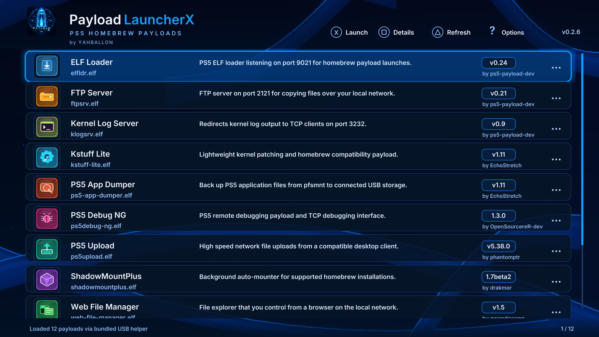

# Payload LauncherX by YAHBALLON
<p align="center">
  
</p>
**Native PS5 USB payload launcher** · **v0.2.6** · **Title ID `PPSA99873`**

A controller-driven PS5 homebrew browser based on [ps5-homebrew-ui](https://github.com/blackbearreloaded/ps5-homebrew-ui), inspired by the supplied blue neon launcher reference. The list is entirely dynamic; no sample payloads or hardcoded fake metadata are bundled.


## Features

- Original USB stick branding included as `sce_sys/icon0.png`, reused in the app header and installable ZIP.

- Discovers payloads from one USB folder per executable in `/mnt/usb0/payloads/`.
- Tries direct native mount access and `/usb0/payloads`, then streams the bundled, read-only `usbscan.elf` to an already running elfldr on `127.0.0.1:9021`. No websrv is needed. Firmware 5.10 behavior has not been hardware tested.
- Reads **`payload.json`** for each item's name, description, version, author and optional explicit executable filename.
- Uses **`payload.png`** as the row thumbnail with a fallback icon when absent or invalid.
- Accepts ELF64 files with `.elf`, `.efl`, and `.bin` names (the actual bytes must contain an ELF64 magic header).
- Offers scrollable rows, details, refreshing, status updates, and persisted automatic refresh and sorting preferences.
- **Running Payloads view (R2)**: queries the real PS5 ELF-daemon process list from the optional [ps5-payload-manager](https://github.com/itsPLK/ps5-payload-manager) service on localhost port **8084**, with PID and memory usage. L2 returns to USB.
- **Kill process**: press X on a listed stoppable daemon and X again in the confirmation dialog. Critical processes such as `elfldr.elf` and `pldmgr.elf` are protected. The backend must be running and may deny the request.
- When ps5-payload-manager is missing or unavailable, the Running Payloads screen explicitly reports this. Processes cannot be inferred merely from successful launch requests. Injected threads will not necessarily appear as standalone processes.
- Sends the selected payload's local file URI to an already-running compatible **elfldr on 127.0.0.1:9021**. This action needs the loader and an appropriate jailbroken runtime; the interface by itself cannot bypass kernel restrictions or supply a privileged ELF loader.

## USB folder structure

```text
/mnt/usb0/payloads/
└── ftpserver/
    ├── ftpserver.elf
    ├── payload.json
    └── payload.png
```

Use one subfolder per payload. The payload filename can also be `ftpserver.efl`, or be named explicitly in `payload.json`. Symlinks and directory traversal paths are deliberately rejected.

Example `payload.json`:

```json
{
  "name": "FTP Server",
  "description": "Starts a local FTP server for file transfers.",
  "version": "v1.2.3",
  "author": "Homebrew Developer",
  "file": "ftpserver.elf"
}
```

`file` may be omitted, in which case the app first looks for a binary matching the subfolder and otherwise selects the first supported extension in that folder. All content shown on screen is read from USB.

## DualSense controller

| Control | Function |
| --- | --- |
| Up / Down / Left Stick | Navigate payload list |
| L1 / R1 | Page backward / forward |
| R2 | Show Running Payloads |
| L2 | Return to USB payload list |
| Cross | Launch selected USB payload, or open/confirm Kill in Running Payloads |
| Circle | Close overlay or exit application |
| Square | Open / close payload details |
| Triangle | Rescan USB directory |
| Options | Open persistent launcher settings |

## Build and release

Source: `native/`.
Workflow: [`.github/workflows/build.yml`](../../.github/workflows/build.yml).
Release tag: `payload-launcher-v0.2.6`.

The workflow copies the known-working PS5-DevBridge C++/OpenGL scaffold, supplies the app source files, downloads the pinned `stb_image.h` header for **offline PNG decoding**, generates the original launcher background and copies the checked-in USB icon to `sce_sys/icon0.png`, compiles natively and validates the release ZIP. Pull requests build only a test artifact; successful pushes to `main` can publish the versioned release. No existing app folders are modified.

## Installation

1. Download `PPSA99873.zip` from a verified successful [release](https://github.com/Yahballon/PS5_Payload_LauncherX/releases/tag/payload-launcher-v0.2.6).
2. Extract its `PPSA99873/` folder to `/data/homebrew/PPSA99873/` on the PS5.
3. Register or refresh the homebrew app with ShadowMountPlus or another compatible launcher.
4. Start a compatible PS5 ELF loader such as [ps5-payload-elfldr](https://github.com/ps5-payload-dev/elfldr) on loopback port 9021 to enable launching.
5. Plug a USB drive containing the structure shown above into the mount mapped as `/mnt/usb0/` and press Triangle to scan.

Only open trusted payloads. A successful submission to a loader is not proof of completed payload execution. PS5 hardware compatibility must be tested on the actual target console.

## Settings

User preferences live in `/data/ps5-payload-launcher/settings.txt`, outside the app directory, so replacing the installed app does not clear them. Settings are loaded at startup and saved atomically when possible.

## Licenses

GPL-3.0-or-later source code. The project uses GPL-3.0-or-later ps5-homebrew-ui and the PS5-DevBridge scaffold. `stb_image.h` from [nothings/stb](https://github.com/nothings/stb) is supplied under the upstream's MIT/public-domain terms. Launcher branding and graphics are original. PS5 firmware files, copyrighted game content, and privileged exploit code are not included.

## v0.2.4 launch fix

The selected ELF is submitted to the existing elfldr with `pipe=0` so that the payload standard streams are detached from the application's short-lived request socket. This avoids prematurely losing the payload's standard streams when the UI closes the connection. Requires validation on firmware 5.10.

## v0.2.4 diagnostics

On launch, display elfldr's response in the status bar. A silent response is reported as unconfirmed, not success.

## v0.2.4

The bundled USB scanner serves the selected ELF to the app via a restricted localhost connection. The app transfers the ELF bytes to the existing elfldr at port 9021. Firmware 5.10 hardware verification is pending.

## v0.2.5 branding update

Replaced the generated PX console icon with the new blue neon USB artwork. The same checked-in `sce_sys/icon0.png` is now packaged with the app and displayed in the header. No payload launch behavior changes.

## v0.2.6 Running Payloads

The new R2 tab uses the PS5 Payload Manager's existing `GET /processes_list` and `POST /process_kill?pid=...` endpoints on `127.0.0.1:8084` (GPL-3.0 upstream). This is optional runtime integration, **not** a bundled copy of that daemon. Only manager-reported standalone ELF daemons appear, and the manager must already be started for process discovery and termination. The launcher checks the selected PID and name again before POSTing a kill. Kill requests can terminate a daemon abruptly; they are never sent without a confirmation step. PS5 hardware runtime behavior still requires verification.
